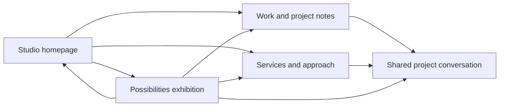

# Reachly — One identity. Two ways in.

**Revised creative and architectural plan**\
**Status:** Approved; implemented as a creative foundation, not a rigid specification. Supersedes the single-experience Wider Possibilities proposal.\
**Branch:** `reachlyid`. Leave `main` untouched.\
**Research:** `reachly-shopify-reference-study.md`; selected captures in `.artifacts/strategy-shopify/`.

## The creative decision

Build one Reachly website with two distinct experiences:

- **Reachly Studio:** the main agency website. Make the business clear, the work credible, and the next step easy.
- **Reachly Possibilities:** an interactive exhibition at `/possibilities`. Demonstrate authored design and technical craft through the experience itself.

These are editorial roles, not separate companies or new sub-brand logos. Both use the official Reachly identity.

**Shared thesis: a point becomes a presence.** The detached reach dot suggests an idea extending beyond its starting position. In Studio it becomes restrained punctuation and connection; in Possibilities it becomes the material of an interactive world.

The contrast is **confidence / curiosity**, not useful / decorative. Studio must be visually exceptional. Possibilities must be understandable and usable.

**Primary surfaces:** Studio is Decide / Learn. Possibilities is Explore, with a guided narrative. Do not average them into one compromised homepage.

## Reconsidering Wider Possibilities

Keep the identity-rooted idea, editorial warmth, real-work emphasis, and the balance of design with practical value. Keep Fraunces and Manrope as the proposed typography pairing.

Move the continuous aperture/connection narrative into the exhibition. Discard the obligation to make every visitor traverse a cinematic six-act homepage. Studio opens through clear typography and substantial real-work imagery; Possibilities opens through an original signal field. They share grammar, not identical scenes.

The previous mask-first/no-WebGL recommendation no longer defines the site's creative ceiling. Use a selectively scoped WebGL scene where it earns the exhibition's result; do not impose it on commercial pages.

## What Shopify establishes

The study examined rendered desktop and mobile composition, typography hierarchy, chapter transitions, navigation, and search—not merely extracted copy.

The [main Shopify experience](https://www.shopify.com/id) is already visually ambitious: cinematic imagery, large aspirational type, concrete demonstrations, unequal image proportions, and accessible conversion paths. Its commercial role does not make it visually timid.

[Winter '26 Editions](https://www.shopify.com/editions/winter2026) establishes a distinct painterly world, extreme chapter scale, contrasting serif explanations, theatrical transitions, and functional wayfinding. Its mobile experience recomposes those scenes rather than shrinking desktop layouts. Direct chapter navigation and search preserve utility inside the spectacle.

Transfer **distinct purpose, shared trust, connected navigation**. Do not transfer Shopify's Renaissance theme, imagery, pink props, fonts, product UI, software-platform claims, or release cadence. An agency exhibition should demonstrate craft, not pretend to be an update catalog.

Detailed observations and verification limits are in the companion research note.

## Business and identity

Speak in English to Indonesian SMEs and entrepreneurs. Make all five approved services legible: Website Design & Development, Digital Presence, Digital Strategy, Business Automation, and SEO.

Use the four owner-confirmed projects: Sellaku, Mac One Indonesia, Crypto Radius, Crypto Galaxy. Attribution and website subjects are established; detailed scopes, dates, testimonials, and measured results are not. Present honest project notes, not invented success stories.

| Material | Brand color | Role |
|---|---|---|
| Cream | `#FAF7F0` | Studio reading canvas and exhibition interludes |
| Ink | `#05100E` | Typography, structure, exhibition opening space |
| Lime | `#D4E751` | Signature signal, active state, selected moments |
| Deep green | `#17463A` | Material depth and quieter reflection |
| White | `#FFFFFF` | Dark-surface lettering where appropriate |

Use the supplied logo variants intact. Dot-derived graphics are separate artwork, never movement or redrawing of the official logo. The serif wordmark informs the character without requiring every headline to imitate it.

This remains a fresh commission. The existing website is not the visual reference. Its markup, device previews, planner, layouts, or stack are not preservation obligations. Align the older repository instructions with the approved direction before coding.

## Reachly Studio — a designed front door

### Visual language

An editorial studio with tangible work: cream space, assertive ink typography, lime punctuation, and carefully composed project imagery. Large serif statements contrast with compact sans labels. A disciplined grid supports asymmetry; each section changes proportion instead of repeating a feature-card template.

**Display:** Fraunces with deliberate weight and optical treatment. **Body/navigation:** Manrope. Self-host a small font set after approval. This pairing remains a proposal until tested in the actual composition.

Use new browser captures, detailed crops, and readable project views. Do not bury real work in elaborate device mockups or recolor every project to manufacture brand uniformity.

### Opening

**Draft headline:**

> A bigger stage.\
> A clearer next step.

**Draft explanation:**

> Websites, digital presence, and connected systems for businesses in Indonesia. Thoughtful design, built around what your business needs next.

Wide, off-center typography anchors the first view. A substantial real-project frame and a smaller contrasting crop sit beside and partly below it; fine captions identify the work. The composition suggests a studio working table, not floating generic cards.

**Primary action:** Discuss your project. **Secondary:** Explore our work. Both are usable immediately. Brief type/image settling adds life without a rotating slogan or mandatory opening animation.

### Homepage sequence

1. **Positioning and visible work:** establish the offer, audience, and next action immediately.
2. **Selected work:** two substantial features followed by a quieter paired composition. Show readable imagery, names, subjects, and project links. Capture all four before ordering; lead with the strongest genuine material.
3. **What needs to change?** Five editorial service rows explain credible websites, coherent touchpoints, priorities, smoother handoffs, and discoverability. Explicit service names remain visible. Selection can update a large explanatory study, but essential information never requires interaction.
4. **A clear way of working:** Discover → Plan → Create → Launch → Improve. Practical explanations build confidence without invented timelines or support terms.
5. **The other side of Reachly:** an expansive exhibition preview, “See what an idea can become.” Place it after evidence and service clarity, not as an obligatory fork at entry.
6. **The invitation:** confident typographic closing, an “I'm not sure where to start” path, and one project-conversation action. Answer scope/next-step questions without inventing packages or prices.

Motion supports attention: measured headline entrances, image-frame continuity into project notes where feasible, tactile controls, and selective dot/line connections. Studio does not inherit the exhibition's scene timeline.

### Supporting pages

- **Work:** complete four-project collection with an art-directed view and direct text index; no elaborate filtering for a small portfolio.
- **Project notes:** real images, attribution, website subject, visit link, and supported delivery information when available.
- **Services:** each approved area explained through concrete problems, possible outputs, and scope boundaries. Individual pages need substantive original content, not thin SEO variations.
- **About:** business focus, approach, and principles—not invented team biographies, awards, address, or history.
- **Contact:** the shared project conversation.

## Reachly Possibilities — an interactive exhibition

### First exhibition: Wider Possibilities

**Draft opening:**

> Small beginnings. Wider possibilities.

A directed exhibition—not a game, a free-roaming 3D office, or disconnected effects. Its story is **make a mark → open the frame → connect the dots → go further**.

Reachly's materials define the world: luminous lime signal, ink space, cream planes, large editorial typography, real project fragments, and elastic connections. Spatial scenes alternate with flat, typographic ones. No stock agency reel or Shopify-inspired paintings.

The opening feels like a crafted instrument. One point bends a precise line field; proximity changes its tension. Scrolling transforms that point into an opening. The scene is composed and compelling before anyone touches it.

The logo, **Back to Studio**, chapter access, motion control, and compact project action remain available. Visitors can follow the story or enter a chapter directly.

### I — Make a mark

A point gains scale against an outsized serif statement. Pointer proximity changes a local field and shifts the signal slightly; typography remains readable DOM content. Touch gets an explicit tap control for authored variations. This is a designed response, not an arbitrary particle swarm.

**Demonstrates:** hierarchy, responsive interaction, custom motion craft.

### II — Open the frame

The point becomes an aperture into a real project capture. One image unfolds into an asymmetrical field of the confirmed projects. Images fan, align, and settle into legible frames—not an endless carousel or wheel-controlled conveyor.

Selecting a project opens focused imagery/context and its canonical Studio project note. Any separate annotated layout experiment is labeled **in-house interaction study**, never a client result or a redesign falsely attributed to the client.

**Demonstrates:** art direction, image handling, spatial continuity, real website work.

### III — Connect the dots

An authored inquiry-flow study connects inquiry → routing → record → notification. **Run the example** sends a visible signal through the sequence. A few labeled scenarios change its route and update a plain-language explanation.

Label it **Illustrative workflow — not connected to a live business system**. Use sample data; do not send an actual inquiry or imply a proprietary automation platform or invented savings metric. Elastic SVG lines add tactility. Buttons and keyboard controls provide every selection; dragging is never required.

**Demonstrates:** interaction logic, systems explanation, design connected to practical workflows.

### IV — Go further

The earlier mark, frames, and connections converge into an expansive ordered composition. A concise reflection returns ambition to useful business choices. Visitors can revisit a chapter, inspect a related service, or choose **Make room for your next idea** to reach Contact.

This is an ending, not another feature grid. It does not suggest every SME website needs WebGL.

### Why it earns its place

Each scene has an idea, an observable response, a capability it demonstrates, and a path to actual work or services. The site must deliver those interactions at production quality before they count as evidence. No fake diagnosis, fictitious launch, or decorative dashboard.

The exhibition is short enough for one visit. Its value is depth and coherence, not dozens of effects. Future exhibitions are possible when there is worthwhile work; no invented seasonal publishing promise.

## One website, connected journeys

### Route map

| Route | Purpose |
|---|---|
| `/` | Studio homepage; default destination |
| `/work` | Confirmed work collection |
| `/work/sellaku` | Sellaku project note |
| `/work/mac-one-indonesia` | Mac One Indonesia project note |
| `/work/crypto-radius` | Crypto Radius project note |
| `/work/crypto-galaxy` | Crypto Galaxy project note |
| `/services` | Five-service overview |
| `/services/website-design-development` | Website Design & Development |
| `/services/digital-presence` | Digital Presence |
| `/services/digital-strategy` | Digital Strategy |
| `/services/business-automation` | Business Automation |
| `/services/seo` | SEO |
| `/about` | Business and approach |
| `/contact` | Shared project conversation |
| `/possibilities` | Canonical launch exhibition |

Chapters use `#mark`, `#frame`, `#connect`, `#further`. No extra launch index between visitor and exhibition. Add future archive structure only when real content warrants it.

### Navigation

Studio: **Work / Services / About / Possibilities / Discuss your project**. Exhibition: Reachly identity, **Back to Studio**, chapters, motion control, and project action. Mobile uses a readable chapter menu with thumb-sized controls.

There is no compulsory splash-screen choice. A prospective client lands on the business. A curious visitor follows the exhibition preview; someone sharing the exhibition can link directly.

Use real links, refreshable routes, normal history, and working Back. A short point/frame transition may connect the experiences; navigation never depends on it. Each experience owns its layout and motion lifecycle.

Crosslinks carry only non-personal context, e.g. `/contact?interest=business-automation&source=possibilities-connect`. Whitelist the values as a starting point, not a diagnosis. Keep names, emails, messages, and brief contents out of URLs/analytics.

Same domain, identity, content records, and inquiry destination establish cohesion. Different layouts and lazy-loaded scenes establish freedom.

## Mobile and motion

Author mobile compositions independently: Studio is an ordered reading journey with generous imagery; Possibilities uses vertical framing, purposeful tap states, and shorter transitions. Do not simulate a cursor or shrink desktop space.

Native scrolling remains the input. Short pinned passages may serve a scene, but are not every section's skeleton. Avoid repeated scrolling that reveals no new meaning.

Reduced-motion and paused states are authored compositions, not frozen halfway through masks. Content/actions remain available. WebGL failure uses DOM/SVG and chosen static states to tell the same story. Audio is unnecessary for comprehension; any later sound would be opt-in.

Type, crop, spacing, and material quality must hold without animation. Real-browser review across phone, tablet, desktop, and wide layouts remains essential.

## Technical recommendation

**Astro + TypeScript + authored CSS. GSAP/ScrollTrigger for coordinated motion. Dynamically imported Three.js for the exhibition opening field.** No React layer unless actual state complexity justifies it.

Astro fits content-led agency pages with isolated interactions. This is a fresh recommendation, not a claim about the existing stack.

- Generate semantic HTML for business pages and exhibition text/index.
- Separate `StudioLayout` and `ExhibitionLayout`; share identity, tokens, type, links, controls, and content records. Scope scene CSS/timelines locally.
- Use CSS/SVG for type, apertures, image formations, and workflow lines. One focused WebGL field supplies responsive material depth; do not turn the website into a canvas.
- Begin with a prepared poster/DOM composition. Enhance once usable; suspend rendering offscreen/paused and dispose on navigation.
- Studio must not fetch the exhibition renderer, shaders, or full media through eager imports or indiscriminate prefetching. Verify the boundary with production build output and cold network traces.
- Optimize new project captures and self-host fonts. Shared verified records prevent contradictory project/service claims.
- Handle chapter hashes, Back, resize, pause, and route transitions intentionally. Missing enhancement must not hide meaningful content.
- Confirm exact versions/licenses during implementation; author Reachly's scenes rather than stitching together Awwwards demos.

Contact asks for the business, desired change, and reply channel, with optional context/review. Production needs a confirmed receiver and data-handling setup. Until then, local testing is explicitly non-delivering: no invented address or false success notification. This is a release dependency, not a planning blocker.

## Resource transformation

| Source | Transferable mechanism | Reachly use |
|---|---|---|
| Shopify main | Expressive clarity and concrete evidence | Ambitious Studio front door |
| Shopify Editions | Art-directed world with functional wayfinding | Coherent exhibition with direct chapters |
| Adidas Arena actual SkillUI captures | Spatial tension, scale, changing density | Exhibition rhythm; no sports identity or copied collage |
| Awwwards `Scroll Animation/9` | Coordinated masks/responsive timelines | Newly authored point-to-aperture continuity |
| Awwwards `Grid Animations/7` | Perspective/convergence | Real-work image field without its lengthy pinning/preload |
| Awwwards `Physics Effects/2` | Elastic Bézier response | Tactile workflow connections with ordinary controls |
| Awwwards `Webgl & ThreeJS Effects/10` | Local signed-distance response | Signal-field research, not a finished drop-in scene |
| Earlier hero/text/menu/slider shortlist | Hierarchy, reversible reveals, continuity | Selective detail and pacing |

The prior survey inventoried 300 packs across 14 categories and visually surveyed category sheets; deeper temporal/source work covered a shortlist, not execution of all 300 applications. This revision adds focused source reading for the exhibition. Source-code inspection is not permission to reuse included artwork.

## Implementation sequence after approval

1. **Foundation:** align instructions, routes, separate shells, shared content/identity, font/media provenance. Work directly on `reachlyid`; no alternative branch or change to `main`.
2. **Prove both languages:** Studio opening + real-work feature; exhibition opening + aperture chapter, each on desktop/mobile. Review together for shared identity and genuine distinction. Prove load isolation/fallbacks at the same time.
3. **Complete the client path:** four project notes, five substantive service pages, About, navigation, Contact. Capture project imagery and refine grounded copy.
4. **Complete the exhibition:** workflow study, ending, chapters, crosslinks, touch states, motion modes. Each interaction must work, not just resemble an interactive screenshot.
5. **Art-direct and verify:** refine type/crops/timing/response; exercise both journeys; test performance/accessibility; integrate and verify the receiver when confirmed. Deliver a working preview with visual evidence. Publishing is separate.

## Acceptance evidence for the future build

These checks are not claims that the planned site has passed them.

- **Clarity:** initial Studio viewport exposes audience, offer, work, and inquiry without waiting. Verify content/capture review and first-visit walkthrough.
- **Honesty:** all five services/four projects have accurate labels and routes; illustrative studies remain distinguishable. Verify records, links, and rendered pages.
- **Cohesion/distinction:** matched desktop/mobile captures show shared identity but different compositions. Exercise crosslinks, refresh, fragments, and Back.
- **Isolation/performance:** cold Studio entry requests no exhibition engine/shaders/full-scene media. Inspect traces/build output; measure both experiences under documented mobile conditions rather than extrapolating desktop smoothness.
- **Interaction:** pointer/touch/keyboard, direct chapters, resize, pause/reduced-motion/WebGL-failure all retain useful content and actions. Verify actual browser states and captures.
- **Inquiry:** verify test submission at the confirmed receiver; rejected/network-failure paths offer recovery without false delivery claims. Use designated test data.
- **Creative quality:** review live compositions/motion at narrow and wide sizes. Build/test/accessibility scores are evidence for their own domains, not substitutes for visual acceptance.

## Approval gate

Planning only. No website source changes, runtime dependency installation, commit, push, merge, or deployment were performed for this revision. Implementation begins only after approval.
